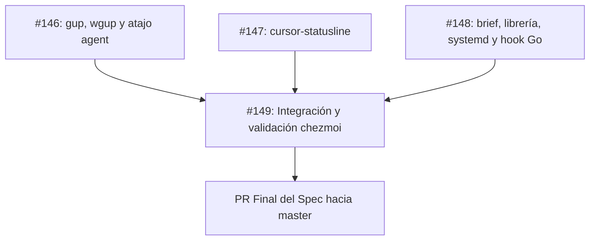

# Plan — robert-flo/HR-CLAVIS#145

- **Spec:** `robert-flo/HR-CLAVIS#145` — `spec: migrar utilidades de pj-domina-rf-tools hacia rf-dotfiles`
- **Repo destino:** `robert-flo/rf-dotfiles` (rama base: `master`)
- **Rama del spec:** `145-migrar-tools-a-rf-dotfiles` en `robert-flo/rf-dotfiles`
- **Repo origen de herramientas:** `/z-home-repos/HR-CLAVIS/pj-domina-rf-tools`
- **Carpeta de handoff:** `/z-home-repos/HR-CLAVIS/.trio/rf-dotfiles-145`
- **Bare repo:** `/z-home-repos/HR-CLAVIS/.bares/rf-dotfiles.git`
- **Raíz de worktrees:** `/z-home-repos/HR-CLAVIS/repos/rf-dotfiles/`

---

## Reglas Obligatorias de Atribución y Dotfiles

1. **FIRMA Y ATRIBUCIÓN (Estricto):**
   - Cero trailers de `Co-authored-by`.
   - Cero menciones a agentes, herramientas de IA o plataformas («Made with Cursor», «Generated by...», etc.).
   - Todo commit y texto de PR se escribe como autor persona (`Roberto Flores <25asab015@ujmd.edu.sv>`).
2. **Chezmoi SSoT (`rf-dotfiles/AGENTS.md`):**
   - Prohibido hardcodear rutas `/home/<user>` en plantillas Chezmoi: usar siempre `{{ .chezmoi.homeDir }}` en archivos `.tmpl`.
   - Herramientas comunes compartidas: van a todos los perfiles, asegurarse de no excluir indebidamente en `.chezmoiignore.tmpl` ni hardcodear usuarios.

---

## Orden de Sub-issues (DAG)

### 1. robert-flo/HR-CLAVIS#146: `gup, wgup y atajo agent: migrar a dot_local/bin en rf-dotfiles`
- **Objetivo:**
  1. Migrar `pj-domina-rf-tools/bin/gup` a `rf-dotfiles/dot_local/bin/executable_gup`.
     - Ajustar para que verifique allowlist en `~/.config/clavis/gup.allow` y `~/.config/robertos/gup.allow`.
  2. Crear enlace relativo `dot_local/bin/symlink_wgup` -> `gup`.
  3. Crear enlace relativo `dot_local/bin/symlink_agent` -> `cursor-agent`.
- **Criterios de aceptación y pruebas:**
  - `bash -n dot_local/bin/executable_gup` sin errores.
  - `wgup` invoca `gup -n` (dry-run).
  - `agent` resuelve a `cursor-agent`.
  - PR a `145-migrar-tools-a-rf-dotfiles`, CI verde, `/code-review` limpio y mergeado a la rama del spec.

### 2. robert-flo/HR-CLAVIS#147: `cursor-statusline: migrar scripts a dot_config/cursor en rf-dotfiles`
- **Objetivo:**
  1. Migrar `pj-domina-rf-tools/statusline/statusline.sh` a `rf-dotfiles/dot_config/cursor/statusline.sh`.
  2. Migrar `pj-domina-rf-tools/statusline/statusline-usage.sh` a `rf-dotfiles/dot_config/cursor/statusline-usage.sh`.
  3. Desacoplar comprobaciones fijas de nixfredOS si no están presentes (hacerlas defensivas/opcionales).
  4. Asegurar permisos de ejecución en los scripts de statusline (`chmod +x` o prefijo Chezmoi `executable_` si aplica según la convención de `dot_config/cursor/`).
- **Criterios de aceptación y pruebas:**
  - `bash -n` en ambos scripts sin errores.
  - Scripts ejecutables y funcionales sin fallar si nixfredOS no existe.
  - PR a `145-migrar-tools-a-rf-dotfiles`, CI verde, `/code-review` limpio y mergeado a la rama del spec.

### 3. robert-flo/HR-CLAVIS#148: `brief: migrar scripts, librería, units systemd y hook de build para brief-table Go`
- **Objetivo:**
  1. Migrar scripts de brief a `rf-dotfiles/dot_local/bin/`:
     - `executable_brief`
     - `executable_brief-session`
     - `executable_brief-trend`
  2. Migrar librería `brief-common.sh` a `rf-dotfiles/dot_local/lib/brief/brief-common.sh`. Actualizar referencias en los scripts.
  3. Migrar código Go `cmd/brief-table/` a `rf-dotfiles/scripts/brief-table/` (`main.go`, `go.mod`, `go.sum`).
  4. Crear hook de Chezmoi `run_onchange_after_install-brief-table.sh.tmpl` que ejecute `go build` hacia `~/.local/bin/brief-table` al detectar cambios en `scripts/brief-table/main.go`.
  5. Migrar units de systemd user a `rf-dotfiles/dot_config/systemd/user/`:
     - `brief.service`
     - `brief.timer`
- **Criterios de aceptación y pruebas:**
  - `bash -n` en todos los scripts de shell.
  - Compilación de `scripts/brief-table` con `go build` exitosa.
  - `brief.service` y `brief.timer` sintácticamente válidos (`systemd-analyze verify` defensivo o chequeo estático).
  - PR a `145-migrar-tools-a-rf-dotfiles`, CI verde, `/code-review` limpio y mergeado a la rama del spec.

### 4. robert-flo/HR-CLAVIS#149: `integracion y validacion: chezmoi apply y verificación de herramientas en sistema`
- **Bloqueado por:** #146, #147, #148.
- **Objetivo:**
  1. Ejecutar `chezmoi diff` en el entorno de pruebas para verificar que no hay colisiones ni rutas no deseadas.
  2. Ejecutar `chezmoi apply` para aplicar las herramientas al entorno real de la estación.
  3. Verificar ejecución real en vivo:
     - `gup --help` y `wgup --help`
     - `brief --help`
     - `brief-table` disponible en `~/.local/bin`
     - `systemctl --user status brief.timer` (o sintaxis verificada)
  4. Documentar evidencia completa en `wk.md`.
  5. Abrir el PR final del spec #145 desde `145-migrar-tools-a-rf-dotfiles` hacia `master` en `robert-flo/rf-dotfiles`.

---

## PR Final y Evaluación de Merge Gate
- **Destino del PR final:** `master` en `robert-flo/rf-dotfiles`.
- **Formato:** Redactado con la skill `/pr`: `## Summary`, `## Evidence` y `## Merge Danger`.
- **Merge Gate:**
  - Se espera `**Door:** two-way` y `**Blast Radius:** Low` (adición de utilidades de usuario en dotfiles).
  - Tras `APRUEBO <sha>` del RV, el PM valida coincidencia de head y ejecuta auto-merge por squash, limpiando ramas y cerrando el ticket.
