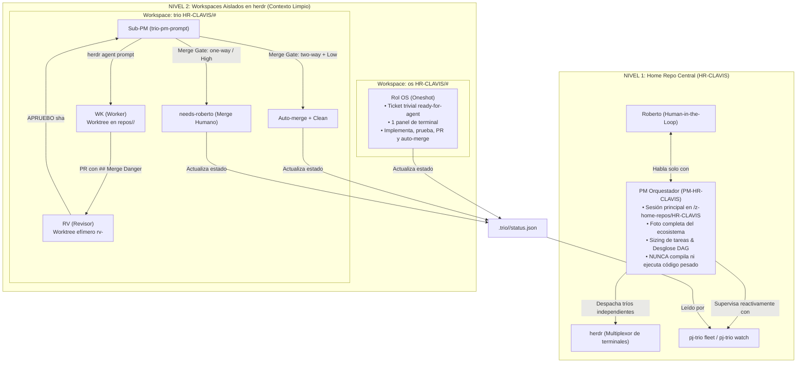
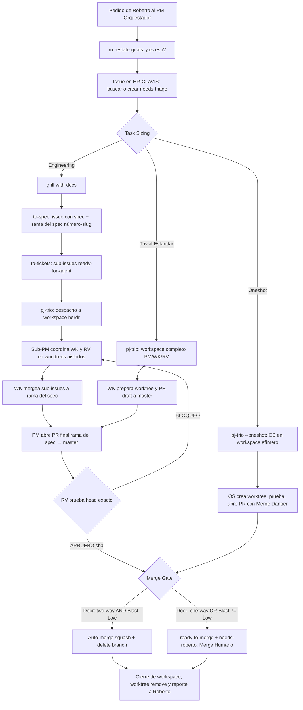

# AGENTS.md — HR-CLAVIS

Este archivo es el **mapa** de HR-CLAVIS para cualquier agente, en cualquier plataforma (agy, Cursor IDE o CLI, Claude Code vía `CLAUDE.md`). Dice por qué existe el repo, cómo está armado, qué supervisa, qué herramientas usa y cómo se opera. **No es el reglamento:** las reglas de cada rol viven en `.agents/reglas/` (las trae `./pj` desde pj-template) y acá solo se enlazan. Si algo de este mapa choca con el dueño de esa verdad (§9), manda el dueño y este archivo se corrige por PR.

> Las secciones marcadas **[HR-CLAVIS]** son propias de este proyecto. El resto es genérico de cualquier Home Repo hijo de pj-template (cambiá `HR-CLAVIS` por `<proyecto>`).

## 0. Si sos un agente, empezá acá

1. ¿Existe `.agents/reglas/`? Si no, corré `./pj listo` antes de nada (sin eso no hay fichas, ni reglas, ni skills, ni repos clonados).
2. Leé tu ficha (`.agents/agents/<ROL>-HR-CLAVIS.md`; en Cursor, `.cursor/rules/pm-hr-clavis.mdc` o `.cursor/agents/{wk,rv}-hr-clavis.md`). Ella te manda a leer `logs.md`, `comun.md` y la regla de tu rol, y nada más.
3. Leé este archivo para ubicarte: arquitectura (§2), repos (§3), herramientas (§6) y circuito (§7).
4. Antes de tocar un repo hijo, leé **su** `AGENTS.md` (§3).
5. Si no sabés algo, buscalo en el dueño (§9). Nunca inventés una regla, una ruta ni un comando: si no está escrito, preguntale a Roberto (vía el PM).

---

## 1. Qué es y por qué existe

HR-CLAVIS es el **Home Repo** del ecosistema PJ-CLAVIS, según el [Home Repo Pattern](https://www.aihero.dev/the-home-repo-pattern): un solo repo que guarda el `AGENTS.md`, las skills y los documentos compartidos, y que **apunta** a los demás repos. Las sesiones de agente arrancan acá, no dentro de un repo suelto.

**El problema que resuelve.** Un agente abierto dentro de un repo solo ve ese repo: cada repo termina con su propia copia de skills y reglas, y un cambio que cruza repos se planea sin la foto completa. Eso es justo lo que pasaba con workstation y dotfiles: retazos de reglas en cada lado y cada agente inventando cómo trabajar.

**Lo que da el patrón:**
- un solo lugar para las reglas, las skills y las herramientas;
- un solo lugar donde corren los agentes;
- cambios que cruzan varios repos desde una misma sesión, con un solo tablero.

**Cómo lo adaptamos (La Jerarquía de Dos Niveles):**
- **Nivel 1: El PM Orquestador vive acá.** Roberto habla **únicamente con el PM-HR-CLAVIS**, que es la única puerta de entrada a todos los repos del proyecto. Su regla de oro: **el PM Orquestador no programa, no compila y no ejecuta tests pesados**. Si ejecutara todo en su propia sesión, saturaría su memoria y ventana de contexto en pocas horas. Su rol es el de **Director de Orquesta**: mira todos los repos juntos, junta los hechos, convierte pedidos en specs y tickets `ready-for-agent` con dependencias DAG, y despacha la ejecución.
- **Nivel 2: Workspaces aislados en herdr con contexto limpio.** Para implementar cada ticket, el orquestador no anida subagentes en su sesión: despacha workspaces independientes en `herdr` con `pj-trio`, donde cada trío (`pm`, `wk`, `rv`) o rol oneshot (`os`) arranca con la memoria 100% limpia para esa tarea puntual.
- **Los repos hijos se clonan adentro** del Home Repo y quedan ignorados por git (la variante «clonarlos adentro y gitignorearlos» del patrón). El código, la historia, los issues propios y el `AGENTS.md` de cada repo se quedan en su repo.
- **Las reglas y las skills no se copian a mano:** HR-CLAVIS es un **hijo de `robert-flo/pj-template` en modo dependencia**. Versiona solo sus datos (`proyecto.yml`, `onboarding.yml`) y unos pocos archivos a mano. Todo lo demás lo trae `./pj` al SHA fijo de `template_ref`.

## 2. Arquitectura



```text
robert-flo/pj-template @ template_ref        (reglas, fichas, skills, scripts, Makefile)
        │  ./pj lo baja a .pj/tpl y genera
        ▼
/z-home-repos/HR-CLAVIS/                     (este repo, rama master)
├── proyecto.yml, onboarding.yml, AGENTS.md… (lo versionado: §5)
├── .pj/            ← template + venv        (generado, ignorado)
├── .agents/        ← fichas agy, reglas, skills (generado, ignorado)
├── .cursor/        ← adaptadores de Cursor  (generado, ignorado)
├── .trio/          ← handoffs de pj-trio    (versionado)
├── PJ-NIRI-rf-omarchy-workstation/   ← clon de un repo hijo (ignorado)
└── rf-dotfiles/                       ← clon de un repo hijo (ignorado)
```

Los clones de arriba son **para leer** (el PM y el contexto de los agentes). Nadie trabaja en ellos: todo worktree de trabajo sale de `ravn-git-bare-clone` (§6.4, ADR 0019 de pj-template):

```
.bares/<repo>.git                  ← bare local del Home Repo (o /z/bare/<repo>.git)
repos/<repo>/                      ← raíz de worktrees del Home Repo (o /z/repos/<repo>)
repos/<repo>/<n>-<slug>/           ← worktree del WK u OS, rama issue/<n>-<slug>
repos/<repo>/rv-<pr>/              ← worktree del RV para probar un PR (rama local rv/<pr>, sin subir)
```

- **Tres capas.** pj-template es el molde (reglas y herramientas comunes a todos los Home Repos). HR-CLAVIS pone los datos del proyecto. Cada repo hijo pone su código y sus reglas propias.
- **Por qué lo generado no se versiona.** agy y Cursor leen `.agents/` y `.cursor/` del disco, pero las fichas citan reglas y skills que tampoco estarían al clonar: versionar solo las fichas daría un clon a medias. `./pj` lo deja todo en disco, igual byte a byte en cualquier máquina porque sale de un SHA fijo. Así el diff de un PR de acá es solo lo que escribió alguien, y actualizar el template es cambiar una línea (`template_ref`). Consecuencia: **en GitHub no se ven los agentes, y está bien.**
- **Dónde vive el clon** (en la PC de Roberto): `/z-home-repos/HR-CLAVIS`, rama `master`. Los repos hijos, adentro, en la carpeta `dir` de `proyecto.yml`.
- **Cada plataforma ve el mismo equipo:**

| Plataforma | PM Orquestador | WK, RV y OS | Cómo se arranca |
| --- | --- | --- | --- |
| agy | `.agents/agents/PM-HR-CLAVIS.md` (enlazado en `~/.gemini/config/agents`) | `WK-`, `RV-`, `OS-HR-CLAVIS.md`; el PM los lanza con `invoke_subagent` o `pj-trio` en herdr | `make agy-pm` (arranque formal completo) o `make pm` (arranque rápido al instante) |
| Cursor (IDE o CLI) | regla `alwaysApply` `.cursor/rules/pm-hr-clavis.mdc`: el chat **es** el PM | subagentes `.cursor/agents/{wk,rv,os}-hr-clavis.md` | abrí `HR-CLAVIS.code-workspace` o corré `cursor-agent` en la raíz |
| herdr (`pj-trio`) | pestaña `pm` con agy | pestañas `wk` y `rv` (trío) o panel único `os` (oneshot) | `pj-trio … <ticket> [--oneshot]` (§6.2) |
| Claude Code | `CLAUDE.md` importa este archivo | — | no tiene fichas propias; leé las de `.agents/agents/` |

## 3. Los repos que supervisa [HR-CLAVIS]

La lista canónica es `repos:` de `proyecto.yml` (la llena `./pj onboard`); `./pj clonar` los clona adentro. Si un repo de abajo falta en disco: `./pj clonar`.

- workstation (vault de arquitectura, ADRs, workflows y proyectos): `PJ-NIRI-rf-omarchy-workstation/`, rama `master`. Clonar desde https://github.com/robert-flo/PJ-NIRI-rf-omarchy-workstation si falta. Leé su `AGENTS.md` primero.
- dotfiles (Chezmoi SSoT y `packages.json` para `niri`, `niri-classic`, `omarchy`): `rf-dotfiles/`, rama `master`. Clonar desde https://github.com/robert-flo/rf-dotfiles si falta. Leé su `AGENTS.md` primero.
- pj-template (plantilla única de tríos PM/WK/RV para Cursor y agy): `pj-template/`, rama `main`. Clonar desde https://github.com/robert-flo/pj-template si falta. Leé su `AGENTS.md` primero.
- fo-herdr-sessionizer (fork de herdr-sessionizer: fzf sobre workspaces y zoxide): `fo-herdr-sessionizer/`, rama `main`. Clonar desde https://github.com/robert-flo/fo-herdr-sessionizer si falta.
- ravn-sessionizer (sessionizer para herdr: workspaces, repos, `pj-*`, agentes y tríos): `ravn-sessionizer/`, rama `main`. Clonar desde https://github.com/robert-flo/ravn-sessionizer si falta. Leé su `AGENTS.md` primero.
- ravn-sessionizer-arch (paquete Arch de `ravn-sessionizer`): `ravn-sessionizer-arch/`, rama `main`. Clonar desde https://github.com/robert-flo/ravn-sessionizer-arch si falta.
- ravn-git-bare-clone-arch (paquete Arch de `ravn-git-bare-clone`): `ravn-git-bare-clone-arch/`, rama `main`. Clonar desde https://github.com/robert-flo/ravn-git-bare-clone-arch si falta.
- ravn-git-bare-clone (launcher y runtime modular de `ravn-git-bare-clone`, Arquetipo A): `ravn-git-bare-clone/`, rama `main`. Clonar desde https://github.com/robert-flo/ravn-git-bare-clone si falta. Leé su `AGENTS.md` primero.
- ravn-trio (trío PM/WK/RV local en herdr, Arquetipo A): `ravn-trio/`, rama `main`. Clonar desde https://github.com/robert-flo/ravn-trio si falta. Leé su `AGENTS.md` primero.
- ravn-trio-arch (paquete Arch de `ravn-trio` / `pj-trio`): `ravn-trio-arch/`, rama `main`. Clonar desde https://github.com/robert-flo/ravn-trio-arch si falta.

| Repo | Qué es | Cómo se prueba (de `onboarding.yml` §wk.como_probar) | Lo que exige el RV (§rv.exige) |
| --- | --- | --- | --- |
| `PJ-NIRI-rf-omarchy-workstation` | El hub: vault de Obsidian con la arquitectura por capas de la estación (00–08), ADRs, `assets/system/` (espejo de `/etc`), scripts y `forkhub` (en transición a su propio repo). | `make audit`, `make test-idempotence`, `make test-secrets` en verde, con la salida en el PR | `shellcheck` limpio y `set -euo pipefail` en cada script que se toque |
| `rf-dotfiles` | Monorepo chezmoi: dotfiles de todos los usuarios de la estación y el manifiesto único de paquetes `.chezmoidata/packages.json`. | `chezmoi diff` sin sorpresas antes de `chezmoi apply`, y aplicado de verdad en la máquina | — |
| `pj-template` | Plantilla única de tríos PM/WK/RV para Cursor y agy (molde de este Home Repo). | — | — |
| `fo-herdr-sessionizer` | Fork de herdr-sessionizer (`fzf` sobre workspaces y zoxide). | — | — |
| `ravn-sessionizer` | Sessionizer para herdr (workspaces, repos, `pj-*`, agentes y tríos). | — | — |
| `ravn-sessionizer-arch` | Paquete Arch de `ravn-sessionizer`. | — | — |
| `ravn-git-bare-clone-arch` | Paquete Arch de `ravn-git-bare-clone`. | — | — |
| `ravn-git-bare-clone` | Launcher y runtime modular de `ravn-git-bare-clone` (Arquetipo A). | — | — |
| `ravn-trio` | Trío PM/WK/RV local en herdr (Arquetipo A). | — | — |
| `ravn-trio-arch` | Paquete Arch de `ravn-trio` (`pj-trio`). | — | — |

**Alcance (decisión de Roberto del 2026-11-16, ADR 0027 del CEO con su enmienda):**
- HR-CLAVIS es la única puerta del ecosistema: su trío **trabaja** la workstation y rf-dotfiles, no solo los mira.
- Todo trabajo se orquesta en los Issues de `robert-flo/HR-CLAVIS`: cada PR en la workstation o en dotfiles **cuelga de un issue de HR-CLAVIS** (§7.1).
- El trío propio de la workstation sigue existiendo y su tablero no se toca. Si los dos tríos chocan en el mismo repo, **gana HR-CLAVIS** y se le avisa a Roberto.

**Notas del vault que importan a este Home Repo** (rutas dentro del clon):
- `08 - AI Developer Workflows/08.3 - Topologia Canonica de Repositorios, Worktrees y GitHub Workflows.md`: dónde vive cada repo en la PC (`/z-home-repos`, `/z/bare`, `/z/repos`, `/z-drive/tries`, `/zt`).
- `08 - AI Developer Workflows/08.7 - Runbook - Crear un Home Repo.md`: cómo poner en marcha o crear un Home Repo.
- `08 - AI Developer Workflows/08.8 - Cómo funciona el trío local (PM-WK-RV, pj-trio, herdr).md`: el trío en herdr, con sus desfases conocidos.

**Otros repos (punteros, no los supervisa el trío):** se leen si una tarea los necesita; un cambio en ellos es otro proyecto y se escala a Roberto.
- pj-omarchy (meta-workspace de Omarchy y del canal `[omarchy-personal]`): `/z/pj-omarchy` en la PC.
- forkhub (forks, bare clones y worktrees; en transición): `PJ-NIRI-rf-omarchy-workstation/scripts/forkhub/`; ver `proyectos/forkhub.md` del vault.
- nvims (suite Neovim): `/z/nvims`. Experimentos: `/z-drive/tries` (`~/Work/tries`). Fuentes de forks del escritorio: `/opt/src`.

> Por qué estos punteros no llevan link de GitHub: `./pj onboard` propone como repos hijos los repos de GitHub que este archivo enlaza. Solo los repos supervisados llevan su URL de `github.com`.

## 4. Lo que el PM tiene que tener al día

El estado que cambia **no se escribe en este archivo**: vive en GitHub y se lee cada vez. Este archivo solo dice dónde mirar.

| Qué | Dónde está la verdad | Cómo se lee |
| --- | --- | --- |
| Qué repos supervisa, su carpeta y su rama | `repos:` de `proyecto.yml` | `./pj onboard --mostrar` |
| Misión, lo que no se toca, cómo prueba el WK, qué exige el RV | `onboarding.yml` | `./pj onboard --mostrar` |
| Specs en curso y cuál va primero | `specs:` de `proyecto.yml` | — |
| Tablero del proyecto | Issues de `robert-flo/HR-CLAVIS` | `gh issue list -R robert-flo/HR-CLAVIS` |
| Issues y PRs abiertos de cada repo hijo | GitHub de cada repo | `gh issue list -R <dueño>/<repo>` y `gh pr list -R <dueño>/<repo>` |
| Rama por defecto de cada repo | GitHub | `gh repo view <dueño>/<repo> --json defaultBranchRef` (tiene que coincidir con `rama` de `proyecto.yml`) |
| Que los clones estén al día | cada clon | `./pj clonar` (fetch, rama de `proyecto.yml`, `pull --rebase --autostash`; no mueve un clon con cambios) |
| Versión del template | `template_ref` de `proyecto.yml` | el PR de sync `pj-template/sync-*` lo sube; se revisa y se mergea como cualquier PR |
| Estado de un trío en herdr | `.trio/<clave>/status.json` | `cat .trio/<clave>/status.json` |
| Que todo cuadre | `./pj check` | tiene que terminar en `check: todo bien` |

Si cambia lo que el PM supervisa (un repo nuevo, otra rama, otra forma de probar), se cambia en `proyecto.yml` / `onboarding.yml` con `./pj onboard` o un PR trivial del WK, y después se actualiza §3 de este archivo en el mismo PR.

## 5. Mapa de archivos

### Versionados (escritos a mano)

`./pj check` falla si se versiona algo fuera de esta lista (más `.trio/`). Un archivo propio nuevo tiene que ir en `extras:` de `proyecto.yml`.

| Archivo | Por qué está | Quién lo escribe |
| --- | --- | --- |
| `proyecto.yml` | Datos del proyecto: nombre, área, rama base, `template_ref`, `repos:`, `specs:`, notas, `extras:`, `skills_extra:`. Lo valida `schema/proyecto.schema.json`. | `./pj onboard` (repos) o un PR; `template_ref` lo sube el PR de sync |
| `onboarding.yml` | El onboarding del trío (misión, no tocar, reglas del proyecto, primeros pasos, cómo prueba el WK, qué exige el RV). `./pj` lo inyecta en las tres fichas. | `./pj onboard` |
| `AGENTS.md` | Este mapa. | PR del WK |
| `README.md` | La portada para humanos: qué es y los comandos de todos los días. | PR del WK |
| `CLAUDE.md` | Una línea, `@AGENTS.md`, para que Claude Code cargue este archivo (extra). | a mano |
| `.gitignore` | Ignora clones, worktrees y temporales. El bloque entre `# >>> HR-CLAVIS: repos (generado) >>>` y `<<<` lo reescribe `./pj`; el resto es a mano. | a mano + `./pj` |
| `pj` | El lanzador del hijo (§6.1). Copia exacta de `plantillas/hijo/pj` de pj-template. **No se edita acá.** | el PR de sync |
| `Makefile` | Atajos a `./pj` (§6.1): `make agy-pm`, `agy-wk`, `agy-rv`, `listo`, `onboard`, `clean`, `check`. Copia exacta de `plantillas/hijo/Makefile` de pj-template (ADR 0020). **No se edita acá.** | el PR de sync |
| `.github/workflows/pj-template.yml` | CI: en cada PR y push corre `./pj check`; a diario (04:17 en El Salvador), a mano o cuando pj-template avisa, abre el PR de sync que sube `template_ref`. Necesita el secreto `PJ_TEMPLATE_TOKEN`. **No se edita acá.** | el PR de sync |
| `HR-CLAVIS.code-workspace` | Workspace de VS Code / Cursor (extra). | a mano |
| `docs/agents/issue-tracker.md`, `triage-labels.md`, `domain.md` | La configuración de las skills de ingeniería de Matt Pocock (`setup-matt-pocock-skills`): tracker, etiquetas y documentos de dominio (extras). | a mano |
| `.trio/README.md`, `.trio/.gitkeep` | La carpeta de handoffs de `pj-trio` (§6.2). Los handoffs `.trio/<clave>/` se commitean. | a mano + el PM en herdr |

### Generados (no se editan ni se versionan)

| Qué | Quién lo genera | Para qué |
| --- | --- | --- |
| `.pj/tpl/` | `./pj` (`git fetch --depth 1` de pj-template al SHA de `template_ref`) | el template: `Makefile`, `scripts/`, `plantillas/`, `schema/`, `docs/pj-template.md` |
| `.pj/venv/` | `scripts/py.sh` (solo si el Python del sistema no trae PyYAML y jsonschema) | Python propio, nunca instala nada en el sistema |
| `.agents/agents/{PM,WK,RV}-HR-CLAVIS.md` | `scripts/generar.py` | fichas de agy, con `proyecto.yml` y `onboarding.yml` adentro |
| `.agents/reglas/{logs,comun,pm,wk,rv}.md` | `generar.py` (copia) | las reglas de los roles |
| `.agents/skills/` | `generar.py` (copia, según `skills-lock.json`) | skills de `robert-flo/skills@personal`, filtradas por rol en `plantillas/roles.yml` |
| `.agents/generados.txt` | `generar.py` | manifiesto de lo generado (lo usan `check` y `clean`) |
| `.cursor/rules/pm-hr-clavis.mdc`, `.cursor/rules/no-cursor-coauthor.mdc`, `.cursor/agents/{wk,rv}-hr-clavis.md` | `generar.py` | el trío en Cursor y la regla que prohíbe el coautor de Cursor |
| `PJ-NIRI-rf-omarchy-workstation/`, `rf-dotfiles/` | `./pj clonar` (`clone-repos.sh`, con `gh repo clone`) | los repos hijos |
| hooks `post-merge` y `post-checkout` en `.git/hooks/` (marcados `# pj-hook`) | `./pj hooks` | cada `git pull` o cambio de rama regenera solo |
| enlaces `~/.gemini/config/agents/{PM,WK,RV}-HR-CLAVIS.md` | `./pj listo` o `./pj enlazar` (`scripts/instalar-agy.sh`) | agy interactivo solo resuelve `--agent` con agentes globales |

## 6. Herramientas

### 6.1 `./pj` (el lanzador del hijo)

El `Makefile` de HR-CLAVIS es solo de atajos y lo manda pj-template (`plantillas/hijo/Makefile`, ADR 0020): cada target llama a `./pj`, la lógica vive ahí. Los demás targets (`humo`, `clonar`, `generar`…) son del `Makefile` de pj-template y se corren con `./pj <target>`.

**Atajos de inicio del trío:**
- **Arranque completo (con pull y regeneración):** `make agy-pm` (o `agy-wk`, `agy-rv`, `agy-os`). Hace `git pull --rebase --autostash` → `./pj listo` → y solo si terminó bien, arranca agy vía mise con `--agent <ROL>-HR-CLAVIS`.
- **Arranque rápido (modo `--solo`):** `make pm`, `make wk`, `make rv`, `make os`. Saltan el pull y la regeneración pesada para abrir el agente en segundos cuando el repo ya está listo.

| Atajo rápido | Atajo completo | Equivale a |
| --- | --- | --- |
| `make pm` | `make agy-pm` | `./pj agy pm [--solo]` |
| `make wk` | `make agy-wk` | `./pj agy wk [--solo]` |
| `make rv` | `make agy-rv` | `./pj agy rv [--solo]` |
| `make os` | `make agy-os` | `./pj agy os [--solo]` |
| `make listo` | — | `./pj listo` |
| `make onboard` | — | `./pj onboard` (`ARGS="--mostrar"`…) |
| `make clean` | — | `./pj clean` (`ARGS="--onboarding"`) |
| `make check` | — | `./pj check` |
| `make` | — | lista los atajos disponibles |

| Comando | Qué hace | Idempotente |
| --- | --- | --- |
| `./pj listo [--abrir]` | Todo de una después de un clone o un pull: `git pull --rebase --autostash` → trae el template → genera → instala hooks → ofrece `./pj onboard` si falta (solo con terminal) → `agy` → `clonar` → `check`. Imprime `make agy-pm`; `--abrir` arranca el PM como `./pj agy pm`. | sí |
| `./pj agy [pm\|wk\|rv\|os] [--solo] [args…]` | Abre ese agente (pm por defecto) en agy vía mise con `--dangerously-skip-permissions --agent <ROL>-HR-CLAVIS args…`. Si no lleva `--solo`, corre `./pj listo` primero. | sí |
| `./pj` | Solo trae pj-template al `template_ref` y genera `.agents/` y `.cursor/`. | sí |
| `./pj onboard` | La entrevista del onboarding: junta los hechos (`proyecto.yml`, README, este archivo, los repos y su stack), propone cada campo (Enter acepta), resume y escribe `onboarding.yml` y `repos:` solo con tu sí. Si ya está hecho, lo muestra y pregunta qué cambiar. `--mostrar` solo imprime; `--si` y `--respuestas F` sin preguntas; `--rehacer` la repite entera. | sí |
| `./pj clean [--onboarding]` | Deshace `./pj listo` para repetirlo: borra `.pj/`, lo generado (solo lo del manifiesto), los hooks `# pj-hook`, los enlaces de agy de este clon y los clones **sin nada local**. Un clon con cambios, ignorados, worktrees, stash, commits o tags sin subir se queda y sale con 1. `--onboarding` además deja `onboarding.yml` y `repos:` sin hacer (se niega si tienen cambios sin commitear). | sí |
| `./pj check` | Esquema de `proyecto.yml` y `onboarding.yml`, idempotencia, regenerar desde cero da los mismos bytes, sin `{{ }}`, sin referencias a otras plataformas, solo los archivos permitidos versionados, `pj`, `Makefile` y el workflow iguales a los del template, skills visibles, humo estático, sintaxis y YAML. | sí |
| `./pj humo` | La prueba de humo; con agy instalado arranca `PM-HR-CLAVIS` sin interacción y exige el autochequeo y la misión. | sí |
| `./pj clonar` | Clona o alinea los repos de `proyecto.yml`. Nunca destruye cambios locales. | sí |
| `./pj enlazar` | Solo enlaza las fichas en `~/.gemini/config/agents` (`./pj listo` ya lo hace). Una vez por máquina **y por usuario**. | sí |
| `./pj hooks` | Instala los hooks que regeneran tras cada pull. No pisa hooks propios. | sí |
| `./pj generar` | Lo mismo que `./pj`, vía el Makefile. | sí |

`skills`, `nuevo-hijo` y `deriva` son targets **solo de pj-template**; no se usan acá. Auth: `PJ_TEMPLATE_TOKEN` si existe (CI); si no, `gh auth git-credential`. `PJ_TEMPLATE_DIR=<checkout>` usa un pj-template local (pruebas). Detalle: `.pj/tpl/docs/pj-template.md`.

### 6.2 `pj-trio` y `trio-status` (el trío en herdr)

- **Qué hace:** abre en herdr un workspace con pestañas a pantalla completa para resolver un ticket en un entorno aislado con contexto limpio.
  - **Modo Trío clásico:** abre 3 pestañas (`pm`, `wk`, `rv`). El sub-PM local orquesta la ejecución técnica del ticket.
  - **Modo Oneshot (`pj-trio --oneshot` o `-1`):** abre un workspace de una sola pestaña (`os`) con el rol `OS-HR-CLAVIS` para tickets de bajo riesgo (`Door: two-way` + `Blast Radius: Low`), ejecutando el ciclo completo hasta el auto-merge.
- **Dónde vive:** código en `robert-flo/ravn-trio`, paquete Arch `ravn-trio` desde `robert-flo/ravn-trio-arch` en `[omarchy-personal]`. Instala `/usr/bin/pj-trio`, `/usr/bin/trio-status` (en `PATH` desde v0.1.13), templates y plugins de herdr.
- **Cómo se usa con HR-CLAVIS:**

```bash
# Lanzar un trío completo para un ticket de un repo hijo
pj-trio /z-home-repos/HR-CLAVIS <ticket> --repo <dir del repo hijo> [--base <rama del spec>]

# Lanzar en modo oneshot para un ticket trivial
pj-trio /z-home-repos/HR-CLAVIS <ticket> --repo <dir del repo hijo> --oneshot

# Inspeccionar el estado de la flota de tríos en herdr
pj-trio fleet

# Monitorear la flota en tiempo real
pj-trio watch
```

- **Protocolo de comunicación entre subagentes (`PM -> WK -> RV -> PM`):**
  1. **Kickoff:** El sub-PM prepara `.trio/<clave>/plan.md`, crea el worktree con `ravn-git-bare-clone` y envía el prompt de trabajo al WK mediante `herdr agent prompt wk-<clave> "..."`.
  2. **Implementación:** El WK trabaja exclusivamente en su worktree aislado, corre pruebas reales (`onboarding.yml` §como_probar), ejecuta `/code-review`, sube el PR draft con `/pr` (incluyendo la sección obligatoria `## Merge Danger`), escribe `.trio/<clave>/wk.md` y notifica al sub-PM vía `herdr agent prompt pm-<clave> "..."`.
  3. **Revisión:** El sub-PM verifica `wk.md` y solicita revisión al RV vía `herdr agent prompt rv-<clave> "..."`. El RV levanta su worktree `rv-<pr>`, corre la verificación estricta (`onboarding.yml` §exige), emite su veredicto en GitHub (`APRUEBO <sha>` o `BLOQUEO`) y en `.trio/<clave>/rv.md`, y notifica al sub-PM.
  4. **Merge Gate y Cierre:** Con `APRUEBO <sha>`, el PM valida el Merge Gate:
     - **Merge Gate automático:** Si el PR clasifica como `Door: two-way` Y `Blast Radius: Low`, el PM ejecuta `gh pr merge --squash --delete-branch --match-head-commit <sha>`, elimina worktrees, actualiza `.trio/<clave>/status.json` a `hecho` y cierra el workspace en herdr.
     - **Merge Gate protegido:** Si el PR clasifica como `Door: one-way` o `Blast Radius != Low`, el PR queda en `ready-to-merge` con `needs-roberto` para que Roberto haga el merge manual.
- **Inspección sin polling:** El PM orquestador de HR-CLAVIS no corre bucles de espera. Consulta el estado consolidado con `pj-trio fleet` o lee directamente `.trio/<clave>/status.json`.
- **Handoff:** `.trio/<clave>/` en el Home Repo, con `<clave>` = `<repo hijo>-<ticket>` (con `--repo`) o `<ticket>`. Lleva `plan.md`, `wk.md`, `rv.md` y `status.json`. Se commitea en HR-CLAVIS.
- **Config:** `trio.conf` por capas (`/usr/share/ravn/trio/trio.conf` → `/zt/ravn/trio/trio.conf` → `.trio/trio.conf`; `PJ_TRIO_CONFIG` reemplaza todo). Fija qué programa corre cada rol y la identidad de git.

### 6.3 `ravn-sessionizer` (el «sessionizer» de herdr)

- **Qué es:** el que a veces se llama «herd-sesionizer» es `ravn-sessionizer`: un `fzf` para moverte por herdr (workspaces, clones, meta-repos y sus miembros, agentes) y lanzar un trío desde un issue con `pj-trio start <pj> <ticket> --repo <miembro>`. Atajos de bash `rs` (repos) y `ri` (issues → trío); en herdr, `prefix+f`, `prefix+a` y `prefix+t` si los configurás.
- **Dónde vive:** código en `robert-flo/ravn-sessionizer`, paquete `ravn-sessionizer` desde `robert-flo/ravn-sessionizer-arch` en `[omarchy-personal]`. Es una reimplementación propia, inspirada en `salkhalil/herdr-sessionizer` (del que hay un fork `robert-flo/fo-herdr-sessionizer` registrado en forkhub).
- **Con HR-CLAVIS:** desde ravn-sessionizer#19 reconoce como proyectos `pj-*` y `HR-*` (`SES_PJ_REGEX='^(pj|hr)-'`) y busca en `/z-drive/tries`, `/z-home-repos` y `/z/repos`, así que HR-CLAVIS aparece como proyecto y `ri` lanza su trío. Si tu `/etc/ravn/sessionizer.conf` es viejo y lo editaste a mano, pacman deja el nuevo como `.pacnew`: copiá `SES_ROOTS` y `SES_PJ_REGEX` de ahí.

### 6.4 `ravn-git-bare-clone` y sus atajos (`git-bare-clone`, `git-create-worktree`, `git-issue-worktree`, `ravn-wt`)

- **Qué hace:** clona un repo en modo bare en `$BARE_HOME/<repo>.git` (por defecto `/z/bare`, o `.bares/` si se ejecuta dentro de un Home Repo) y arma worktrees en `$WORKTREES_HOME/<repo>/<rama>` (por defecto `/z/repos`, o `repos/` dentro de un Home Repo), dejando libre la rama por defecto para que varios agentes trabajen en paralelo sin colisionar. `sync` crea los worktrees que falten; `create <nombre>` y `issue <n> <slug>` crean un worktree nuevo.
- **Versión actual:** `v0.2.1` (paquete Arch `ravn-git-bare-clone` en `[omarchy-personal]`, instalado en `/opt/ravn-git-bare-clone` con binarios en `/usr/bin`). Desde v0.2.1 cuenta con detección automática de Home Repos, tests automatizados de idempotencia en CI y el alias CLI `ravn-wt`.
- **Con HR-CLAVIS:** **es la única forma permitida de crear worktrees** (ADR 0019 de pj-template; fleet ADR 0011: nunca `git worktree add` a mano). `ravn-git-bare-clone clone <dueño>/<repo>` es idempotente y prepara las estructuras canónicas. Si el issue vive en el repo del código, `git-issue-worktree -r /z/repos/<repo> -B <base> <n> <slug>`; si vive en HR-CLAVIS, `git-create-worktree -r /z/repos/<repo> -B <base> -b issue/<n>-<slug> -p '' <n>-<slug>`. Los dos dejan `/z/repos/<repo>/<n>-<slug>` en la rama `issue/<n>-<slug>`. Al terminar, `git -C /z/repos/<repo> worktree remove <ruta>`. Los clones dentro de HR-CLAVIS son solo para lectura; `./pj clean` nunca toca `/z/bare` ni `/z/repos`.

### 6.5 Las demás

| Herramienta | Qué es | Dónde vive / cómo se instala | Uso en HR-CLAVIS |
| --- | --- | --- | --- |
| `gh` | CLI de GitHub, logueado como `robert-flo` | paquete `github-cli` | issues, PRs, veredictos, merges, clones; también da las credenciales para bajar pj-template |
| `herdr` | gestor de workspaces de terminal para agentes | paquete de `[omarchy-personal]` (≥ 0.9.5) | donde corre `pj-trio` en sus modalidades trío y oneshot |
| `agy` | Antigravity, el motor de las fichas (`antigravity-cli` de mise) | en la PC | `make agy-pm` / `make pm` (o `agy --agent PM-HR-CLAVIS`) |
| `try` / try-clone | clones rápidos con fecha en `/z-drive/tries` | `robert-flo/try-clone` | `pj-trio` y `ravn-sessionizer` lo usan para clonar lo que falta |
| forkhub | auditoría de forks, bare clones y topología | `PJ-NIRI-rf-omarchy-workstation/scripts/forkhub/` (en transición) | se trabaja como parte de la workstation |
| `sync-arch-package-secrets.sh` | herramienta de sincronización de secretos de empaquetado Arch | `PJ-NIRI-rf-omarchy-workstation/scripts/secrets/` | sincroniza `GPG_PRIVATE_KEY` y `REPO_DEPLOY_KEY` en repos `*-arch` desatendidamente |

## 7. Cómo se opera

Las reglas completas de cada paso están en `.agents/reglas/` (`pm.md` §Tu flujo, `wk.md` §Tu flujo, `rv.md`, `comun.md` §Git y §El tablero). Esto es el recorrido.

### 7.1 Dónde va cada issue [HR-CLAVIS]

- Todo pedido empieza con un issue en **`robert-flo/HR-CLAVIS`** (tablero global, specs). Antes de crear, se busca (`gh issue list --search`).
- Si el cambio cae en un repo hijo, el ticket que implementa el WK vive **en ese repo** (es lo que lee `pj-trio --repo`), enlazado al issue de HR-CLAVIS del que cuelga. Un spec que cruza repos lleva uno en cada repo, enlazados (`comun.md` §Reglas de GitHub).
- El PR cierra el ticket de su repo (`Closes #N`) y nombra el issue de HR-CLAVIS.

### 7.2 Task Sizing (antes de elegir el camino)

Lo usa el PM en `pm.md` §Tu flujo 3. Viene de `robert-flo/Template`; es una convención local encima del flujo de Matt Pocock, no de sus skills.

1. **Engineering (Trío completo):** todo lo que agrega, cambia o quita lógica de negocio, scripts complejos, contratos de comportamiento, pipelines o arquitectura. Requiere flujo completo: `grill-with-docs` → `to-spec` → `to-tickets` → Trío PM/WK/RV en herdr (`pj-trio`).
2. **Trivial Estándar (WK + RV + PM):** cambios con impacto en múltiples archivos o que requieren validación cruzada pero sin spec largo (refactor menor, sync de dependencias, scripts de soporte). Issue `ready-for-agent` → Trío `pj-trio` → PR con revisión de RV y merge del PM.
3. **Oneshot (Bajo riesgo / Auto-merge):** cambios atómicos de bajo riesgo (docs, correcciones tipográficas, atajos, configs simples, bumps de versión directos) clasificados como `Door: two-way` Y `Blast Radius: Low`. Se resuelven con un agente único (`make os` en local o `pj-trio --oneshot` en herdr), quien crea worktree, prueba, corre `code-review`, sube PR y auto-mergea al validar el Merge Gate.

El PM **dice en voz alta** la clasificación y el camino antes de empezar, para que Roberto pueda vetarla. Si duda, Engineering.

### 7.3 El circuito



- **Rama del spec** (ADR 0006 de pj-template): `<número>-<slug>`, la crea el PM desde la rama por defecto al publicar el spec, sin commits suyos. Los PRs del WK van a ella; su único PR final va a `master`.
- **Worktree del WK / OS** (`wk.md` paso 3, ADR 0019 de pj-template): uno nuevo por issue, siempre con `ravn-git-bare-clone` (§6.4) en `/z/repos/<repo>/<n>-<slug>`, rama `issue/<n>-<slug>`. `<base>` es `origin/<rama del spec>` en un sub-issue y `origin/HEAD` en un trivial. Al terminar, `git -C /z/repos/<repo> worktree remove <ruta>`. Nunca `git worktree add` a mano ni trabajo en los clones del Home Repo.
- **PR:** body obligatorio con la skill `pr` conteniendo tres secciones estrictas:
  1. `## Summary`: descripción concisa y bullets del cambio.
  2. `## Evidence`: prueba real ejecutada con comandos y salidas completas.
  3. `## Merge Danger`: clasificación de reversibilidad (`Door: two-way` | `one-way`) y alcance del impacto (`Blast Radius: Low` | `Medium` | `High`).
- **RV:** prueba el PR de verdad en un worktree aislado `/z/repos/<repo>/rv-<pr>` (`git-create-worktree -N -r /z/repos/<repo> -B origin/<rama-del-PR> -b rv/<pr> -p '' rv-<pr>`) y comenta en el PR `APRUEBO <sha>` o `BLOQUEO` con archivo y línea. No programa, no mergea, no cambia etiquetas.
- **Merge Gate Canónico:**
  - **Auto-merge:** Aplica únicamente si el veredicto es `APRUEBO <sha>` y el bloque `## Merge Danger` certifica `Door: two-way` Y `Blast Radius: Low`. El PM (o el OS) ejecuta:
    `gh pr merge <N> --squash --delete-branch --match-head-commit <sha>`.
  - **Escalación humana (`needs-roberto`):** Si `Door: one-way` o `Blast Radius != Low`, el PR no se auto-mergea; se etiqueta `ready-to-merge` y se solicita confirmación explícita de Roberto antes del merge.
- **Sub-issue → rama del spec:** lo mergea el **WK**, con CI verde y `code-review` limpio, sin pasar por RV.
- **Hecho:** issue cerrado por el merge y sin etiquetas de triage; ramas y worktrees borrados.
- **El PR de sync** (`pj-template/sync-*`, lo abre la CI) es un PR más: pasa por el RV y lo mergea el PM.
- **Etiquetas:** `needs-triage`, `needs-info` (con `ON HOLD: <motivo>`), `spec`, `ready-for-agent`, `ready-to-merge`, `wontfix`.

### 7.4 En herdr

Con `pj-trio` (§6.2) el trabajo técnico se despacha a un workspace independiente:
1. **Lanzamiento:** El orquestador ejecuta `pj-trio <pj> <ticket> --repo <repo> [--base <base>]` o `pj-trio <pj> <ticket> --repo <repo> --oneshot`.
2. **Supervisión sin bucles:** El PM orquestador inspecciona con `pj-trio fleet` o monitorea interactivamente con `pj-trio watch`.
3. **Flujo interno:** Los agentes se comunican entre sí mediante `herdr agent prompt <id> "..."` y dejan sus handoffs en `.trio/<clave>/`.
4. **Cierre:** Al finalizar con éxito (`status.json` en `hecho`), se remueven los worktrees en `/z/repos/<repo>/`, se commitea el handoff `.trio/` en HR-CLAVIS y se destruye el workspace temporal en herdr (`herdr kill-workspace <id>`). Si falla dos veces consecutivas, pasa a `needs-roberto` y dispara `notify-send`.

## 8. Reglas duras

Estas no se negocian en ningún repo del proyecto. Su dueño es `comun.md` §Git y §Tu PC (y `onboarding.yml`); acá se resumen para que nadie las pase por alto.

- **Identidad de git en todo commit:** `Roberto Flores <25asab015@ujmd.edu.sv>`.
- **Cero trailers ni firmas de agentes:** ningún commit lleva trailer ni firma: ni `Co-authored-by`, ni `agente: … · plataforma: …`, ni ninguna otra atribución en ningún repo.
- **Pull previo:** antes de trabajar y antes de cada push: `git pull --rebase --autostash`.
- **Nunca push force:** nunca `git push --force` ni `--force-with-lease`: si la historia publicada no cuadra, rama nueva y PR nuevo.
- **Nunca commit directo a master:** nunca commits directos a la rama por defecto ni a la rama de un spec: rama auxiliar o worktree, PR, revisión, merge y limpiar la rama.
- **Ramas base:** la rama por defecto de los repos propios es `master`; en los forks propios se trabaja en `personal`.
- **Nunca PRs hacia upstream ni StatIndet:** nunca abrir PRs, ramas ni pushes hacia upstreams (`omacom/omarchy` ni ningún otro); nunca PRs hacia `StatIndet`.
- **Secretos:** nunca en texto plano (archivos, cli, chat, logs). Para sincronizar secretos en repos de empaquetado Arch (`*-arch`), seguir estrictamente el runbook canónico `pj-template/docs/runbook-secrets-empaquetado-arch.md` usando `PJ-NIRI-rf-omarchy-workstation/scripts/secrets/sync-arch-package-secrets.sh`.
- **La única puerta a `/` es `pacman` vía `[omarchy-personal]`.**
- **Registro en `CAMBIOS.md`:** todo paquete Arch en su repo `*-arch` debe reflejar sus versiones y cambios en `CAMBIOS.md` antes del release.
- **Bloque obligatorio `## Merge Danger`:** todo PR sin excepción debe incluir reversibilidad (`Door: two-way|one-way`) y radio de explosión (`Blast Radius: Low|Medium|High`) para evaluar el Merge Gate.
- **Idempotencia:** toda automatización tiene que ser reproducible e idempotente: correrla una o diez veces deja el mismo estado.
- **Arreglos en el origen:** van en el repo dueño, nunca como parche manual en la máquina.
- **Temporales:** van en `~/.cache/ravn-piloto/`; `/zt/` es zona efímera y nada permanente vive ahí.
- **Bóveda intacta:** nunca tocar `~/Work/tries/_boveda` (la bóveda cifrada) ni su sincronización.
- **Archivos protegidos:** nunca se editan a mano `.agents/`, `.cursor/`, `.pj/`, `./pj` ni el workflow: se cambian en pj-template.

## 9. Dónde vive cada verdad (y quién manda si chocan)

| Qué | Dueño |
| --- | --- |
| Reglas de los roles, Git, tablero, tu PC | `.agents/reglas/{logs,comun,pm,wk,rv}.md` (de pj-template; se cambian con un issue en `robert-flo/pj-template`) |
| Decisiones del trío (merge, rama del spec, onboarding…) | `docs/adr/` de pj-template (`.pj/tpl/docs/adr/`) |
| Términos (trío, rama del spec, listo para mergear) | `GLOSSARY.md` de pj-template |
| Cómo funciona el modo dependencia, la CI y el secreto | `.pj/tpl/docs/pj-template.md` |
| Cómo corre el trío en herdr | `robert-flo/ravn-trio` (README y `trio-pm-prompt.md`); si choca con las reglas de pj-template, mandan las de pj-template y se corrige ravn-trio |
| Datos del proyecto | `proyecto.yml` |
| Onboarding del trío | `onboarding.yml` |
| Arquitectura del proyecto y este mapa | este `AGENTS.md` y `README.md` |
| Topología de la PC y runbooks | notas 08.3, 08.7 y 08.8 del vault de la workstation |
| Reglas propias de cada repo hijo | el `AGENTS.md` de ese repo |
| Qué paquetes se instalan | `.chezmoidata/packages.json` de rf-dotfiles |

Precedencia: en datos manda tu ficha; en reglas, `.agents/reglas/`; en arquitectura, este archivo. Si encontrás dos fuentes que se contradicen, no elijas en silencio: decilo y proponé el arreglo en el dueño.

## 10. Qué no es este repo

- No es un repo de código: acá no se programa nada de la workstation ni de dotfiles. El código se cambia en su clon y su PR va a su repo.
- No es una copia de las reglas: si una regla falta o está mal, se arregla en pj-template, no en este archivo.
- No es el lugar del estado: issues, PRs y avances viven en GitHub y en `.trio/`, no en este archivo.
- No es donde viven los clones permanentes de Roberto: los repos hijos de acá son para el trío; la topología de la PC está en 08.3.
- No es el único trío del ecosistema: el de la workstation sigue con su tablero (§3).

---

## Agent skills

### Issue tracker

Los issues y specs viven en GitHub Issues de `robert-flo/HR-CLAVIS` (CLI `gh`); los tickets de un repo hijo, en ese repo (§7.1). See `docs/agents/issue-tracker.md`.

### Triage labels

Vocabulario por defecto: `needs-triage`, `needs-info`, `ready-for-agent`, `ready-to-merge` (rol ready-for-human), `wontfix`. See `docs/agents/triage-labels.md`.

### Domain docs

Single-context: un `GLOSSARY.md` y `docs/adr/` en la raíz, creados cuando hagan falta (si se crean, van en `extras:` de `proyecto.yml`). See `docs/agents/domain.md`.

---

## Cómo cambiar este archivo

Como todo: issue trivial en HR-CLAVIS, PR del WK, `APRUEBO` del RV y merge del PM. Si cambiás algo genérico (sin **[HR-CLAVIS]**), pensá si también va a la plantilla del `AGENTS.md` de los hijos en pj-template.
